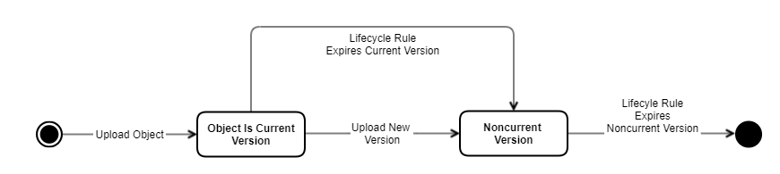
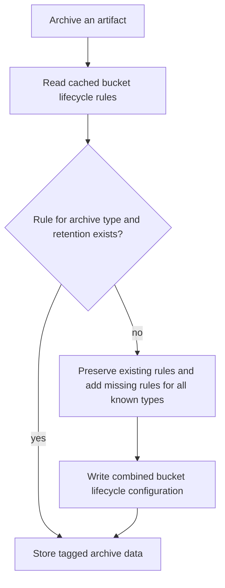

# Data expiration & locking

Every [archive type](archive-types.md) defines a retention period in days (`expirationDays` in the
descriptor, or `expiration-days` for config-defined types). During this period archived data is
protected from manipulation (overwrite, delete) in the object store. Deleting data after the period is
ultimately the responsibility of the archiving system — **the PAS never deletes data**. To support this,
the PAS configures S3 lifecycle rules and object locks.

## Lifecycle rules

Before storing data, the PAS ensures S3 lifecycle configuration rules exist on the bucket. For a
versioned object these rules:

- transition the current version to *noncurrent* after `expirationDays` days (a delete marker becomes
  the current version);
- permanently delete a *noncurrent* version after a further `expirationDays` days.

For a version that remains current until expiry, the two configured periods total
`2 × expirationDays`. A version overwritten earlier becomes noncurrent earlier, so its noncurrent
period starts at that point. Lifecycle eligibility is not an exact deletion timestamp, and object lock
can postpone deletion. A delete marker hides the object from ordinary reads; older versions can still
be read by version ID until physically deleted. See the
[S3 lifecycle action reference](https://docs.aws.amazon.com/AmazonS3/latest/userguide/intro-lifecycle-rules.html).

For example, with a retention period of 10 days, version 1 uploaded on day 0 and replaced on day 4
becomes eligible for noncurrent-version deletion after day 14. If version 2 is not replaced, its
current-version expiry is after day 14 and its noncurrent-version expiry after day 24. These are
illustrative eligibility periods, subject to the store's lifecycle scheduling and object retention.

The PAS manages the rules additively: it creates lifecycle rules for all archive types it knows, and if
a rule is missing when storing data it reads the existing configuration, preserves its rules, adds
missing rules for all known types and writes the resulting configuration back. Adding the complete
set avoids partial rule sets from identically configured PAS instances. Rule IDs and object tags
include the archive type and retention periods, so a changed retention configuration does not silently
replace the policy for already archived data.

You can inspect an object's expiry with:

```bash
aws s3api head-object --bucket <bucket> --key <key>   # see the "Expiration" field
```



The [AWS diagram of deletion in a versioned bucket](https://docs.aws.amazon.com/AmazonS3/latest/userguide/images/versioning_DELETE_versioningEnabled.png)
illustrates how a delete marker hides an object while retaining its earlier versions. The retention and
lock rules above still apply to physical deletion.

### Ensuring bucket lifecycle rules



Lifecycle configuration is maintained per bucket when storing data. Object tags select the rule for
that artifact's archive type and retention settings.

For a non-AWS S3 endpoint, add `--endpoint-url <endpoint>` to the CLI commands. A `head-object`
response can include an `Expiration` value such as
`expiry-date="Thu, 01 Oct 2020 09:07:48 GMT", rule-id="rule2"`; the rule ID identifies the matching
bucket policy. This is lifecycle information, while `get-object-retention` reports the lock's
`RetainUntilDate`.

## Object lock

In addition to the lifecycle rules, the PAS places an object lock on the stored data that protects it
from manipulation — and also from the automatic lifecycle deletion — for the retention period. If a
lifecycle deletion would fall before the lock expires, it is deferred until the lock expires.

```bash
aws s3api get-object-retention --bucket <bucket> --key <key>   # see Mode and RetainUntilDate
```

## Configuration

Object-lock properties and defaults are listed in [Configuration](configuration.md#object-storage).

With `COMPLIANCE` objects may be undeletable for a long time, which is often undesirable on non-prod
environments. A common per-environment setup is:

| Environment | Object lock                                                   |
|-------------|---------------------------------------------------------------|
| DEV / REF   | `object-lock-enabled = false`                                 |
| ABN         | `object-lock-enabled = true`, `object-lock-mode = GOVERNANCE` |
| PROD        | `object-lock-enabled = true`, `object-lock-mode = COMPLIANCE` |

## Related

- [Object storage](object-storage.md)
- [Archive types](archive-types.md)
- [Configuration reference](configuration.md)
