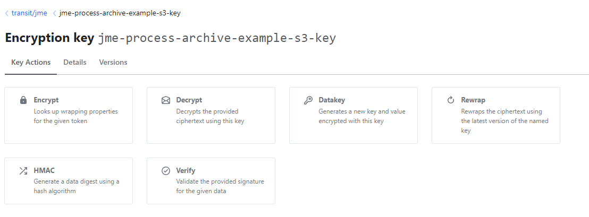

# Encryption

The PAS can encrypt archived payloads before storing them in S3, and it can consume encrypted Kafka
records. Both use the [jEAP Crypto](https://jeap-admin-ch.github.io/docs/building-blocks/libraries/jeap-crypto/) library and a key
management system (HashiCorp Vault, AWS KMS, …).

## Encrypting data at rest

Encryption is enabled per [archive type](archive-types.md) by referencing an encryption key in the
descriptor. If no key is defined, the data is stored unencrypted.

```json
{
  "archiveType": "Decree",
  "encryptionKey": { "keyId": "my-archive-data-key" }
}
```

`keyId` is the id of a key in the PAS's jEAP Crypto configuration, which in turn points to a key in the
key management system. Two prerequisites must be met:

1. A jEAP Crypto starter is on the classpath, for example AWS KMS:

   ```xml
   <dependency>
       <groupId>ch.admin.bit.jeap</groupId>
       <artifactId>jeap-crypto-aws-kms-starter</artifactId>
   </dependency>
   ```

2. jEAP Crypto is configured and can access the key:

   ```yaml
   jeap:
     crypto:
       awskms:
         keys:
           my-archive-data-key:
             key-arn: "${test-key-arn}"
   ```

At startup the PAS validates each configured encryption key by performing a test encryption, so
misconfiguration fails fast. If no data needs encryption, no key management system is required.

### Legacy encryption definition (Vault only)

Older descriptors reference a Vault transit key directly. This cannot be combined with `encryptionKey`:

```json
{
  "archiveType": "Decree",
  "encryption": { "secretEnginePath": "transit/jme", "keyName": "jme-process-archive-example-s3-key" }
}
```

Create the key in the configured Vault transit engine before using the descriptor, for example:

```bash
vault write -f transit/jme/keys/jme-process-archive-example-s3-key
```

For the modern `encryptionKey` form, configure a jEAP Crypto key ID that points to this Vault key
or to an existing AWS KMS key. See [jEAP Crypto key management](https://jeap-admin-ch.github.io/docs/building-blocks/libraries/jeap-crypto/key-management)
and the complete [archive example](https://github.com/jme-admin-ch/jme-process-archive-example)
and [crypto example](https://github.com/jme-admin-ch/jme-crypto-example).



## Consuming encrypted Kafka records

The PAS can consume encrypted Kafka records through jEAP Messaging and jEAP Crypto. The record carries
information about the wrapping key; the PAS instance must have access to the corresponding key management
system. See [Encrypting messages](https://jeap-admin-ch.github.io/docs/building-blocks/libraries/jeap-messaging/encrypting-messages)
for dependencies and configuration. Decrypting an incoming Kafka message and encrypting the archived
payload are separate operations and can use different keys.

## Related

- [Archive types](archive-types.md)
- [Object storage](object-storage.md)
- [Getting started](getting-started.md)
